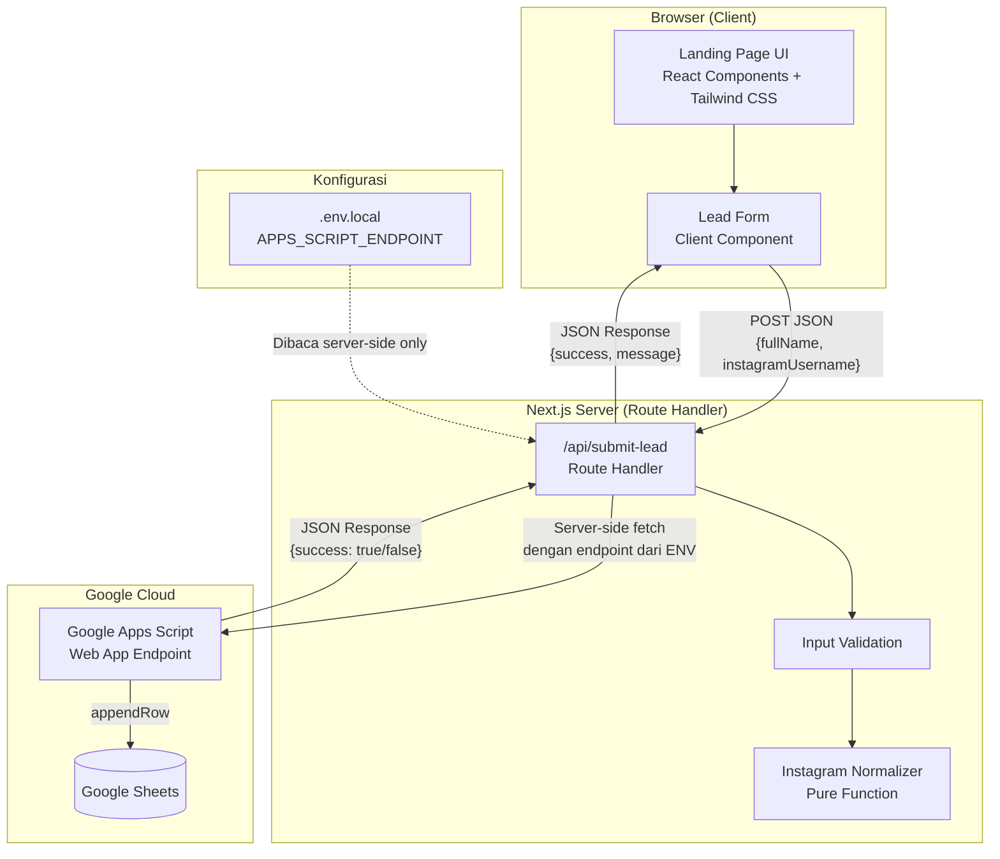
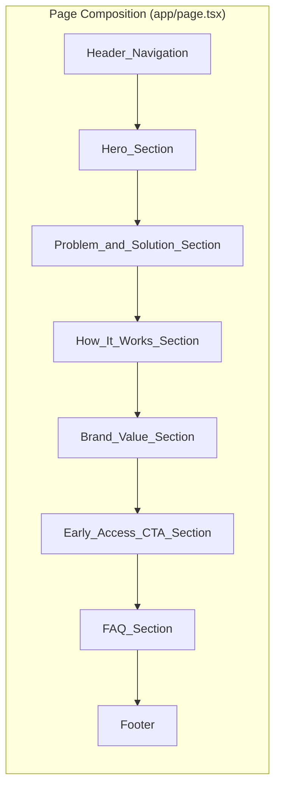
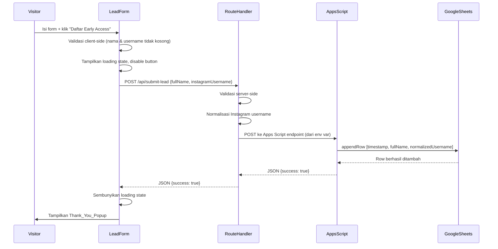
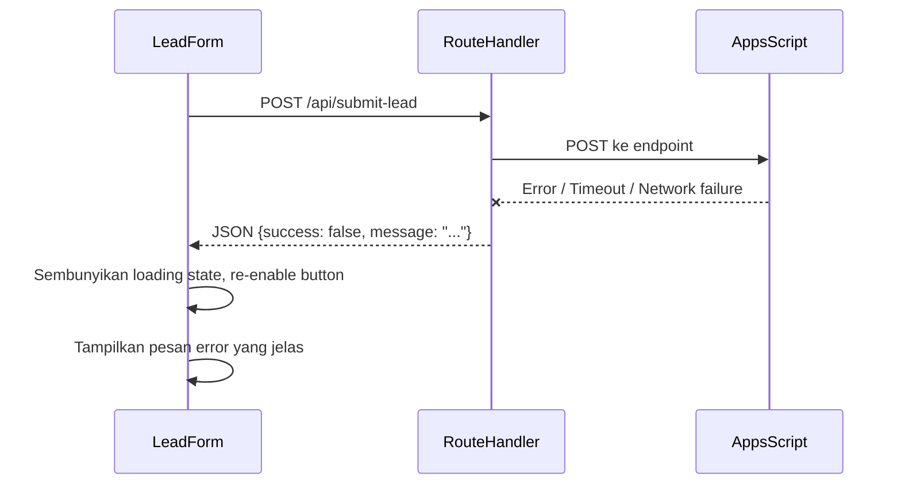
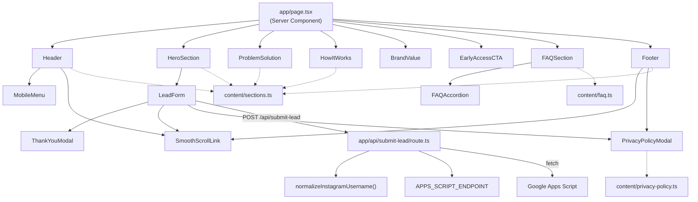

# Design Document

## Overview

Dokumen ini mendefinisikan desain teknis untuk landing page OffLoad Laundry, sebuah layanan laundry premium berbasis online yang berada dalam tahap pre-launch di SCBD, Jakarta Selatan. Landing page ini bertujuan memperkenalkan brand OffLoad Laundry, membangun awareness, dan mengumpulkan early access leads melalui sebuah lead form sederhana dengan dua field: Nama Lengkap dan Instagram Username.

Desain ini mencakup seluruh 21 requirement dan 79 acceptance criteria yang telah disetujui dalam `requirements.md`. Pendekatannya adalah membangun single-page application yang terasa seperti website brand premium yang siap menyambut calon pelanggan, bukan template atau halaman tugas, dan yang pastinya tidak menyiratkan layanan sudah bisa dipesan.

### Teknologi yang Digunakan

| Teknologi | Peran |
|-----------|------|
| Next.js (App Router) | Framework frontend dengan server-side rendering |
| TypeScript | Bahasa pemrograman dengan type safety |
| Tailwind CSS | Utility-first CSS framework untuk styling |
| Google Apps Script Web App | Endpoint backend untuk menerima submission dan menulis ke Google Sheets |
| Google Sheets | Penyimpanan data lead sementara |
| Vercel | Hosting dan deployment platform |
| GitHub | Version control dan penyimpanan source code |

### Catatan Arsitektur Masa Depan

PostgreSQL disebutkan dalam stack teknologi sebagai database untuk pengembangan sistem selanjutnya (pemesanan laundry lengkap, autentikasi, dll). Namun, PostgreSQL **tidak digunakan** pada tahap landing page ini. Integrasi lead form sepenuhnya mengandalkan Google Sheets melalui Google Apps Script. Arsitektur dibangun dengan pemisahan yang jelas antara logika submission dan UI, sehingga migrasi ke PostgreSQL di masa depan dapat dilakukan tanpa mengubah komponen UI.

### Keputusan Desain Utama

1. **Server-side proxy untuk menyembunyikan endpoint URL**: Browser tidak melakukan request langsung ke Google Apps Script. Sebagai gantinya, browser mengirim POST ke Route Handler Next.js sendiri (`/api/submit-lead`), dan server-side code meneruskan request ke Apps Script endpoint menggunakan environment variable yang tidak terekspos ke browser. Ini memenuhi Requirement 12.4 dan 12.5 (endpoint tidak diekspos di frontend source, tidak ada hardcoded credentials). Sumber: [Stack Overflow - Hiding URL in fetch request](https://stackoverflow.com/questions/71744973/hiding-url-in-fetch-request-on-client-side-in-next-js)

2. **Pure function untuk Instagram Normalization**: Normalisasi username Instagram diisolasi sebagai pure function terpisah (`normalizeInstagramUsername`) untuk memungkinkan property-based testing terhadap sifat idempotence (Req 9.4) dan confluence (Req 9.5).

3. **Single-page dengan smooth scroll**: Seluruh konten dirender dalam satu halaman React. Navigasi antar-section menggunakan smooth scroll, bukan routing antar halaman (Req 1.2, 4.1).

4. **Konten terpisah dari komponen**: Seluruh copy website (headline, FAQ, Privacy Policy, dll.) disimpan dalam file konfigurasi konten terpisah (`content/`), sehingga komponen UI bersifat reusable dan perubahan copy tidak mengubah logika komponen.

---

## Architecture

### Diagram Arsitektur Sistem



### Arsitektur Single-Page

Landing page dibangun sebagai single-page application menggunakan Next.js App Router. Seluruh section dirender dalam satu route (`/`) dan navigasi antar-section dilakukan melalui smooth scroll. Tidak ada client-side routing tambahan yang memuat halaman baru.



### Alur Submission Lead Form



Jika proses gagal:



### Pemisahan Lapisan

| Lapisan | Tanggung Jawab | Lokasi |
|---------|---------------|--------|
| **UI Layer** | Merender section, form, modal, navigation. Menangani interaksi visual (hover, focus, loading state). | `components/` |
| **Content Layer** | Menyimpan seluruh copy website (headline, FAQ, Privacy Policy, microcopy) sebagai data terstruktur. | `content/` |
| **Validation Layer** | Memvalidasi input form (nama tidak kosong, username tidak kosong) di sisi client dan server. | `lib/validation.ts` |
| **Normalization Layer** | Pure function yang menormalisasi Instagram username (trim whitespace, hapus leading @). | `lib/instagram-normalizer.ts` |
| **Integration Layer** | Route Handler yang menerima submission, memvalidasi, menormalisasi, dan meneruskan ke Apps Script endpoint. | `app/api/submit-lead/route.ts` |
| **Configuration Layer** | Environment variables dan konfigurasi endpoint yang hanya dapat diakses server-side. | `.env.local`, `.env.example` |

---

## Components and Interfaces

### Daftar Komponen

Komponen UI dibagi menjadi tiga kategori: section komponen (struktur halaman), interaktif komponen (form, modal, accordion), dan utility komponen (button, input, container).

#### Section Komponen

| Komponen | Tipe | Requirements Terkait |
|----------|------|----------------------|
| `Header` | Server Component | Req 3 (Header Navigation) |
| `HeroSection` | Server Component + Client interaksi | Req 2 (Above-the-fold Hero), Req 7 (Lead Form placement) |
| `ProblemSolution` | Server Component | Req 21.1 |
| `HowItWorks` | Server Component | Req 21.2 |
| `BrandValue` | Server Component | Req 21.3 |
| `EarlyAccessCTA` | Server Component | Req 21.4 |
| `FAQSection` | Server Component + Client interaksi | Req 16 (FAQ Accordion) |
| `Footer` | Server Component | Req 21.5 |

#### Interaktif Komponen (Client Components)

| Komponen | Tipe | Requirements Terkait |
|----------|------|----------------------|
| `LeadForm` | Client Component (`'use client'`) | Req 7, 8, 10, 11, 12 |
| `ThankYouModal` | Client Component | Req 11 |
| `PrivacyPolicyModal` | Client Component | Req 14 |
| `FAQAccordion` | Client Component | Req 16 |
| `MobileMenu` | Client Component | Req 3.3 |
| `SmoothScrollLink` | Client Component | Req 4 |

#### Utility Komponen

| Komponen | Tipe | Kegunaan |
|----------|------|----------|
| `Button` | Server/Client Component | Tombol reusable dengan variants (primary, accent) |
| `Input` | Client Component | Input field dengan label terprogram |
| `Container` | Server Component | Wrapper dengan max-width dan padding konsisten |
| `SectionHeading` | Server Component | Heading dengan hierarchy konsisten |

### Signature Komponen Kunci

#### LeadForm

```typescript
// components/forms/LeadForm.tsx
'use client'

interface LeadFormProps {
  // Tidak ada props eksternal; form self-contained
}

interface LeadFormState {
  status: 'idle' | 'submitting' | 'success' | 'error'
  errors: {
    fullName?: string
    instagramUsername?: string
  }
  submitError?: string
}

// Memvalidasi field saat submit
// Menampilkan loading state saat submitting
// Menampilkan ThankYouModal saat success
// Menampilkan error message saat error
// Mencegah double submission saat submitting
```

#### Instagram Normalizer (Pure Function)

```typescript
// lib/instagram-normalizer.ts

/**
 * Menormalisasi Instagram username menjadi format konsisten.
 * Aturan:
 * 1. Trim leading dan trailing whitespace
 * 2. Hapus karakter "@" di awal jika ada
 * 3. Kembalikan hasil tanpa "@" dan tanpa whitespace di sekitarnya
 *
 * Sifat: idempotent (Req 9.4) dan confluent (Req 9.5)
 */
function normalizeInstagramUsername(raw: string): string
```

#### Route Handler (Integration Layer)

```typescript
// app/api/submit-lead/route.ts

interface SubmitLeadRequest {
  fullName: string
  instagramUsername: string
}

interface SubmitLeadResponse {
  success: boolean
  message?: string
}

// Menerima POST request dari LeadForm
// 1. Parse JSON body
// 2. Validasi: fullName tidak kosong, instagramUsername tidak kosong
// 3. Normalisasi instagramUsername menggunakan normalizeInstagramUsername
// 4. Tambahkan timestamp (ISO 8601)
// 5. Baca APPS_SCRIPT_ENDPOINT dari environment variable
// 6. Jika endpoint tidak dikonfigurasi: return {success: false, message: "Endpoint belum dikonfigurasi"}
// 7. POST ke Apps Script endpoint: {timestamp, fullName, normalizedInstagramUsername}
// 8. Parse response dari Apps Script
// 9. Return {success: true/false} ke client
export async function POST(request: Request): Promise<Response>
```

#### ThankYouModal

```typescript
// components/forms/ThankYouModal.tsx
'use client'

interface ThankYouModalProps {
  isOpen: boolean
  onClose: () => void
}

// Menampilkan title "Kamu Sudah Masuk Daftar!"
// Menampilkan message "Terima kasih sudah tertarik dengan OffLoad Laundry..."
// Menampilkan button "Oke, Mengerti"
// Button onClose menutup modal
```

#### PrivacyPolicyModal

```typescript
// components/modals/PrivacyPolicyModal.tsx
'use client'

interface PrivacyPolicyModalProps {
  isOpen: boolean
  onClose: () => void
}

// Menampilkan draft Privacy Policy dari project brief
// Tombol close menutup modal
// Escape key menutup modal
// Scrollable pada mobile viewport
```

### Diagram Komponen dan Dependency



---

## Data Models

### Tipe Data Utama

```typescript
// types/index.ts

/** Data mentah dari form submission sebelum validasi/normalisasi */
interface LeadSubmission {
  fullName: string
  instagramUsername: string
}

/** Data setelah validasi dan normalisasi, siap dikirim ke Apps Script */
interface NormalizedSubmission {
  timestamp: string                 // ISO 8601, ditambahkan server-side
  fullName: string                  // sudah di-trim
  normalizedInstagramUsername: string  // sudah dinormalisasi (tanpa @, tanpa whitespace)
}

/** Response dari Route Handler ke client */
interface SubmitLeadResponse {
  success: boolean
  message?: string                  // pesan error jika success=false
}

/** Response dari Google Apps Script */
interface AppsScriptResponse {
  success: boolean
  message?: string
}

/** Item FAQ untuk accordion */
interface FAQItem {
  question: string
  answer: string
}

/** Status form submission */
type FormStatus = 'idle' | 'submitting' | 'success' | 'error'

/** Error validasi per field */
interface ValidationErrors {
  fullName?: string
  instagramUsername?: string
}
```

### Model Data Google Sheets

Setiap submission yang berhasil membuat satu baris baru di Google Sheets dengan struktur kolom berikut:

| Kolom | Tipe Data | Sumber | Contoh |
|-------|-----------|--------|--------|
| Timestamp | String (ISO 8601) | Server-side, saat diterima Route Handler | `2026-01-15T10:30:00.000Z` |
| Full Name | String | Form input (sudah di-trim) | `Budi Santoso` |
| Instagram Username | String | Form input (sudah dinormalisasi) | `budisantoso` |

Kolom tambahan (email, phone, address, dll.) **tidak boleh** ditambahkan (Req 12.2, 12.3).

### Model Konfigurasi

```typescript
// .env.example
// APPS_SCRIPT_ENDPOINT - URL Google Apps Script Web App
// Tidak menggunakan NEXT_PUBLIC_ prefix agar tidak diekspos ke browser

APPS_SCRIPT_ENDPOINT=https://script.google.com/macros/s/XXXXX/exec
```

```typescript
// Konfigurasi warna (Tailwind config extension)
interface ColorPalette {
  primary: string       // Deep teal / dark green - #0D4F4A
  secondary: string     // Soft mint / light aqua - #B8E6E0
  accent: string        // Warm yellow - #F5C842
  background: string    // White / very light neutral - #FAFAFA
  text: string          // Dark charcoal - #2A2A2A
  footer: string        // Deep navy / dark teal - #0A2E2C
}
```

### Model Konten

```typescript
// content/sections.ts
interface HeroContent {
  eyebrow: string
  headline: string
  supportingCopy: string
  formHeading: string
  formSupportingText: string
}

interface ProblemSolutionContent {
  headline: string
  supportingCopy: string
  benefits: Array<{
    title: string
    description: string
  }>
}

interface HowItWorksContent {
  headline: string
  supportingCopy: string
  steps: Array<{
    title: string
    description: string
  }>
}

interface BrandValueContent {
  headline: string
  bodyCopy: string
}

interface EarlyAccessCTAContent {
  headline: string
  supportingCopy: string
  buttonText: string
}

interface FooterContent {
  wordmark: string
  description: string
  navLinks: Array<{ label: string; target: string }>
  privacyPolicyLink: string
  copyright: string
}
```

---
## Correctness Properties

*A property is a characteristic or behavior that should hold true across all valid executions of a system—essentially, a formal statement about what the system should do. Properties serve as the bridge between human-readable specifications and machine-verifiable correctness guarantees.*

Setelah menganalisis seluruh 79 acceptance criteria, sebagian besar requirement bersifat UI rendering, layout, dan interaksi yang paling tepat diuji dengan example-based tests dan integration tests. Namun, terdapat area di mana Property-Based Testing (PBT) memberikan nilai signifikan, khususnya pada `Instagram_Normalizer` (pure function dengan sifat idempotence dan confluence yang eksplisit) dan validasi form (penolakan input whitespace-only).

### Property 1: Instagram Normalizer Idempotence

*For any* string input, applying `normalizeInstagramUsername` twice SHALL produce the same value as applying it once.

**Validates: Requirements 9.4**

### Property 2: Instagram Normalizer Confluence

*For any* two username inputs that differ only by a leading "@" character or surrounding whitespace, `normalizeInstagramUsername` SHALL produce identical stored values. The output SHALL always be in a single consistent format: no leading "@" and no leading or trailing whitespace.

**Validates: Requirements 9.1, 9.2, 9.3, 9.5**

### Property 3: Whitespace-Only Input Rejection

*For any* string composed entirely of whitespace characters, submitting it as the value for "Nama Lengkap" or "Instagram Username" SHALL be rejected by form validation, and the form SHALL prevent submission and display a validation error.

**Validates: Requirements 8.1, 8.2**

### Property 4: No Horizontal Scroll at Any Viewport Width

*For any* viewport width of at least 320px, the rendered landing page SHALL not produce horizontal scrolling (i.e., the document scroll width SHALL not exceed the viewport width).

**Validates: Requirements 5.4**

### Property 5: WCAG AA Contrast Compliance

*For any* combination of text color and background color used in the design system, the contrast ratio SHALL satisfy WCAG AA standards (at least 4.5:1 for normal text, at least 3:1 for large text and UI component boundaries like buttons).

**Validates: Requirements 6.4**

---

## Error Handling

### Strategi Error Handling

Error handling dirancang untuk memberikan feedback yang jelas kepada pengunjung dan mencegah kehilangan data, sambil tetap menjaga keamanan (tidak mengekspos detail endpoint atau kredensial).

### Tabel Error Scenarios

| Skenario | Penyebab | Tindakan Sistem | Requirements Terkait |
|----------|---------|-----------------|----------------------|
| Field nama kosong/whitespace | Pengunjung submit tanpa mengisi nama | Tampilkan pesan error pada field, cegah submission | Req 8.1 |
| Field Instagram kosong/whitespace | Pengunjung submit tanpa mengisi username | Tampilkan pesan error pada field, cegah submission | Req 8.2 |
| Endpoint belum dikonfigurasi | `APPS_SCRIPT_ENDPOINT` env var kosong | Route Handler return `{success: false, message: "Endpoint belum dikonfigurasi"}`, tampilkan pesan error generik di form, re-enable submit button | Req 13.1, 13.2 |
| Network error / timeout | Apps Script endpoint tidak merespons | Tampilkan pesan error "Gagal terhubung. Silakan coba lagi.", re-enable submit button | Req 10.3 |
| Apps Script return error | Apps Script gagal menulis ke Google Sheets | Tampilkan pesan error "Terjadi kesalahan. Silakan coba lagi.", re-enable submit button | Req 10.3, 11.2 |
| Thank You popup tidak muncul | Submission gagal | Popup TIDAK ditampilkan (hanya muncul saat success=true) | Req 11.2 |
| Modal Privacy Policy tidak bisa tutup | Escape key atau close button tidak berfungsi | Pastikan event listener untuk Escape dan onClick untuk close button terpasang dengan benar | Req 14.3, 14.4 |

### Prinsip Error Handling

1. **Tidak ada false success**: Pop-up sukses hanya muncul setelah endpoint benar-benar mengembalikan respons sukses (Req 11.1, 11.2). Tidak ada simulasi sukses palsu.
2. **Pesan error yang jelas**: Setiap error menghasilkan pesan yang dapat dipahami pengunjung, tidak menampilkan detail teknis atau stack trace.
3. **Re-enable setelah error**: Submit button selalu di-re-enable setelah error, sehingga pengunjung dapat mencoba lagi (Req 10.3).
4. **Pencegahan double submission**: Saat loading state aktif, submit button di-disable dan form tidak menerima submission tambahan (Req 10.1, 10.2).
5. **Tidak mengekspos endpoint**: Pesan error tidak boleh mengandung URL Apps Script endpoint atau informasi kredensial (Req 12.4, 12.5).
6. **Validasi ganda**: Validasi dilakukan baik di sisi client (untuk feedback instan) maupun server (Route Handler, untuk keamanan).

### Pseudocode Error Handling Route Handler

```typescript
// app/api/submit-lead/route.ts
export async function POST(request: Request): Promise<Response> {
  try {
    const body = await request.json()

    // 1. Validasi server-side
    if (!body.fullName || isWhitespaceOnly(body.fullName)) {
      return Response.json({ success: false, message: "Nama lengkap wajib diisi." })
    }
    if (!body.instagramUsername || isWhitespaceOnly(body.instagramUsername)) {
      return Response.json({ success: false, message: "Instagram username wajib diisi." })
    }

    // 2. Normalisasi
    const normalizedUsername = normalizeInstagramUsername(body.instagramUsername)
    const trimmedName = body.fullName.trim()

    // 3. Baca endpoint dari env var
    const endpoint = process.env.APPS_SCRIPT_ENDPOINT
    if (!endpoint) {
      return Response.json({ success: false, message: "Endpoint belum dikonfigurasi." })
    }

    // 4. Kirim ke Apps Script
    const timestamp = new Date().toISOString()
    const response = await fetch(endpoint, {
      method: 'POST',
      headers: { 'Content-Type': 'application/json' },
      body: JSON.stringify({
        timestamp,
        fullName: trimmedName,
        instagramUsername: normalizedUsername,
      }),
    })

    // 5. Parse response
    const result = await response.json()
    return Response.json({ success: result.success === true })

  } catch (error) {
    // Error generik - tidak mengekspos detail
    return Response.json({ success: false, message: "Terjadi kesalahan. Silakan coba lagi." })
  }
}
```

---

## Testing Strategy

### Pendekatan Dual Testing

Testing menggunakan kombinasi property-based tests dan example-based tests, dengan integration tests untuk verifikasi eksternal.

### 1. Property-Based Tests (PBT)

PBT digunakan untuk menguji sifat universal yang harus berlaku untuk semua input valid. Library yang digunakan: **fast-check** (property-based testing library untuk TypeScript/JavaScript).

| Property | Yang Diuji | Fungsi Target | Requirements |
|----------|-----------|---------------|-------------|
| Property 1: Idempotence | `normalize(normalize(x)) === normalize(x)` untuk semua string x | `normalizeInstagramUsername` | Req 9.4 |
| Property 2: Confluence | Input yang berbeda hanya by @/whitespace menghasilkan output yang sama; output selalu tanpa @ dan tanpa whitespace | `normalizeInstagramUsername` | Req 9.1, 9.2, 9.3, 9.5 |
| Property 3: Whitespace rejection | String whitespace-only ditolak oleh validasi | `validateLeadForm` | Req 8.1, 8.2 |
| Property 4: No horizontal scroll | Layout tidak menghasilkan horizontal scroll untuk viewport ≥320px | Render output CSS | Req 5.4 |
| Property 5: WCAG AA contrast | Semua kombinasi warna text/background memenuhi rasio kontras AA | Design system color pairs | Req 6.4 |

**Konfigurasi PBT:**
- Minimum 100 iterasi per property test
- Setiap test diberi tag: `Feature: simsalaclean-landing-page, Property {N}: {property_text}`
- Property 1-3: pure function tests (cepat, in-memory)
- Property 4: layout tests (memerlukan render di berbagai viewport width, gunakan mock rendering)
- Property 5: design system tests (hitung contrast ratio dari pasangan warna, pure function)

**Library yang digunakan:**
- `fast-check` untuk property-based testing
- `vitest` sebagai test runner
- Contoh tag pada test: `// Feature: simsalaclean-landing-page, Property 1: Instagram Normalizer Idempotence`

### 2. Unit Tests (Example-Based)

Unit tests fokus pada contoh spesifik, edge cases, dan integration points antar komponen.

| Area Test | Yang Diverifikasi | Requirements |
|----------|-------------------|-------------|
| LeadForm rendering | Field labels, placeholders, button text, microcopy, Privacy Policy link | Req 7.1-7.7 |
| Form validation | Submit dengan nama kosong → error; submit dengan username kosong → error; submit valid → initiate | Req 8.1-8.4 |
| Form submission states | Loading state muncul saat submit; double submit dicegah; error menampilkan pesan + re-enable | Req 10.1-10.3 |
| ThankYouModal | Konten (title, message, button); close pada button click; hanya muncul saat success | Req 11.1-11.4 |
| PrivacyPolicyModal | Open pada link click; tidak navigasi; close pada button; close pada Escape; scrollable di mobile; konten Privacy Policy | Req 14.1-14.6 |
| FAQAccordion | Lima item; expand/collapse pada click; konten Q&A | Req 16.1-16.4 |
| Header navigation | Wordmark, nav links, CTA button; horizontal di desktop; mobile menu di mobile | Req 3.1-3.3 |
| Smooth scroll | Nav link scroll ke section; CTA scroll ke lead form | Req 4.1-4.3 |
| Page composition | Section order benar; tidak load halaman tambahan | Req 1.1-1.2 |
| Section content | Setiap section menampilkan konten yang benar (headline, cards, steps, dll.) | Req 21.1-21.5, 2.3 |
| Pre-launch messaging | Konten menyatakan pre-launch; tidak ada testimonial/rating/pricing; tidak ada lorem ipsum | Req 18.1-18.3 |
| Language | Body copy dan form labels dalam Bahasa Indonesia | Req 19.1 |
| Contact integrity | Tidak ada kontak fiktif; placeholder jelas ditandai | Req 20.1-20.2 |
| Instagram normalization | Contoh spesifik: `"@budi"` → `"budi"`, `"  budi  "` → `"budi"`, `"budi"` → `"budi"` | Req 9.1-9.3 |

### 3. Integration Tests

Integration tests memverifikasi interaksi dengan layanan eksternal (Google Apps Script dan Google Sheets).

| Area Test | Yang Diverifikasi | Requirements |
|----------|-------------------|-------------|
| Google Sheets integration | Submission berhasil membuat row baru dengan timestamp, nama, username | Req 12.1 |
| Payload verification | Hanya 3 field dikirim (timestamp, fullName, instagramUsername); tidak ada field tambahan | Req 12.2, 12.3 |
| Endpoint test | Saat endpoint tersedia, test submission menghasilkan row di Google Sheet | Req 13.3 |
| Route Handler proxy | Endpoint URL tidak muncul di frontend bundle; request melalui proxy server-side | Req 12.4 |

**Pendekatan Integration Test:**
- Gunakan mock untuk Apps Script endpoint saat unit testing (menjaga biaya rendah)
- Jalankan 1-3 integration test dengan endpoint nyata untuk verifikasi end-to-end
- Tag: `// Integration: Google Sheets Integration, Requirements 12.1`

### 4. Smoke Tests

Smoke tests memverifikasi konfigurasi dan setup satu kali.

| Area Test | Yang Diverifikasi | Requirements |
|----------|-------------------|-------------|
| Endpoint configuration | `APPS_SCRIPT_ENDPOINT` ada di env var, tidak di frontend | Req 12.4 |
| No hardcoded secrets | Tidak ada kredensial di source code | Req 12.5 |
| Favicon exists | File favicon ada dan ter-referensi di metadata | Req 15.1 |
| Favicon on production | Favicon dapat diakses di URL production | Req 15.3 |
| No GTM | Tidak ada GTM container di source code | Req 17.1 |
| No GA4 | Tidak ada GA4 code di source code | Req 17.2, 17.3 |

### 5. Responsive Design Tests

Responsive design diuji dengan contoh spesifik di setiap breakpoint.

| Breakpoint | Viewport Width | Yang Diverifikasi | Requirements |
|------------|--------------|-------------------|-------------|
| Desktop | ≥1280×720 | Hero above the fold; horizontal nav; desktop layout | Req 2.1, 3.2, 5.1 |
| Tablet | 640-1023px | Tablet layout; penyesuaian spacing/font | Req 5.2 |
| Mobile | 360×640 | Form above the fold; mobile menu; mobile layout; modal readable/scrollable | Req 2.2, 3.3, 5.3, 14.5 |

### 6. Visual Regression Tests

| Area Test | Yang Diverifikasi | Pendekatan |
|----------|-------------------|------------|
| Hero section | Headline, supporting copy, dan form visible above the fold | Screenshot comparison di desktop dan mobile viewport |
| Section layouts | Setiap section terender dengan benar di semua breakpoint | Screenshot comparison |
| Modal rendering | Privacy Policy dan Thank You modal terender dengan benar | Screenshot comparison |
| Color scheme | Primary, secondary, accent, background, text, footer colors sesuai design system | Visual inspection / automated CSS verification |

### Deployment Strategy

#### Environment Configuration

```bash
# .env.local (development - tidak di-commit)
APPS_SCRIPT_ENDPOINT=https://script.google.com/macros/s/XXXXX/exec

# .env.example (template - di-commit)
# Salin file ini ke .env.local dan isi dengan URL Apps Script endpoint
APPS_SCRIPT_ENDPOINT=
```

#### Deployment Steps

1. **GitHub Repository**: Source code di-push ke GitHub repository
2. **Vercel Project Setup**: Hubungkan Vercel ke GitHub repository
3. **Environment Variables**: Set `APPS_SCRIPT_ENDPOINT` di Vercel dashboard (Settings → Environment Variables)
   - Penting: JANGAN gunakan `NEXT_PUBLIC_` prefix agar endpoint tidak terekspos ke browser
4. **Build Configuration**: Vercel auto-detect Next.js, jalankan `npm run build`
5. **Production Deploy**: Deploy otomatis dari main branch
6. **Post-Deploy Verification**:
   - Verifikasi favicon muncul di browser tab (Req 15.3)
   - Test submission lead form dan konfirmasi row muncul di Google Sheets (Req 13.3)
   - Verifikasi tidak ada GTM/GA4 di network tab (Req 17.1-17.3)
   - Verifikasi responsive di desktop, tablet, mobile (Req 5.1-5.3)

#### Google Apps Script Setup

Apps Script Web App perlu dikonfigurasi untuk menerima POST request dan menulis ke Google Sheets:

1. Buat Google Sheet dengan header row: `Timestamp | Full Name | Instagram Username`
2. Buka Extensions → Apps Script dari Google Sheet
3. Implementasi `doPost(e)` function yang:
   - Menerima JSON body dari Route Handler
   - Menulis row baru ke sheet
   - Mengembalikan JSON response `{success: true/false}`
4. Deploy sebagai Web App:
   - Execute as: Me
   - Who has access: Anyone
5. Copy Web App URL ke `APPS_SCRIPT_ENDPOINT` environment variable

Sumber: [Google Sheets is my favourite free backend](https://dev.to/pavel_polivka/google-sheets-is-my-favourite-free-backend-4no5), [Better Sheets - doPost guide](https://bettersheets.co/explained/do-post)

#### PBT Library Configuration

```json
// package.json (devDependencies)
{
  "vitest": "^latest",
  "fast-check": "^latest",
  "@testing-library/react": "^latest",
  "@testing-library/jest-dom": "^latest",
  "jsdom": "^latest"
}
```

```typescript
// vitest.config.ts
import { defineConfig } from 'vitest/config'

export default defineConfig({
  test: {
    environment: 'jsdom',
    include: ['tests/**/*.test.ts', 'tests/**/*.test.tsx'],
  },
})
```

### Testing Execution Commands

```bash
# Menjalankan seluruh tests (single execution, bukan watch mode)
npx vitest run

# Menjalankan hanya property-based tests
npx vitest run tests/property

# Menjalankan hanya unit tests
npx vitest run tests/unit

# Menjalankan integration tests (memerlukan endpoint aktif)
npx vitest run tests/integration

# Build production
npm run build

# Type check
npx tsc --noEmit
```

---

## Struktur Folder Proyek

```
offloadlaundry-landing-page/
├── app/
│   ├── layout.tsx                  # Root layout: metadata, font, favicon reference
│   ├── page.tsx                    # Single-page landing (komposisi semua section)
│   ├── globals.css                 # Tailwind directives + custom CSS
│   ├── icon.tsx                    # Dynamic favicon (monogram OffLoad Laundry)
│   └── api/
│       └── submit-lead/
│           └── route.ts            # Server-side proxy ke Apps Script endpoint
├── components/
│   ├── layout/
│   │   ├── Header.tsx              # Header navigation + mobile menu
│   │   └── Footer.tsx              # Footer dengan wordmark, links, copyright
│   ├── sections/
│   │   ├── HeroSection.tsx         # Hero dengan headline, supporting copy, lead form
│   │   ├── ProblemSolution.tsx      # 3 benefit cards
│   │   ├── HowItWorks.tsx          # 3 conceptual steps
│   │   ├── BrandValue.tsx          # Brand belief section + visual
│   │   ├── EarlyAccessCTA.tsx      # CTA section sebelum footer
│   │   └── FAQSection.tsx          # FAQ dengan accordion
│   ├── forms/
│   │   ├── LeadForm.tsx            # Form 2 field + validation + submission states
│   │   └── ThankYouModal.tsx       # Modal konfirmasi sukses
│   ├── modals/
│   │   └── PrivacyPolicyModal.tsx  # Modal Privacy Policy (Escape + close)
│   ├── ui/
│   │   ├── Button.tsx              # Reusable button (primary, accent variants)
│   │   ├── Input.tsx               # Input field dengan accessible label
│   │   ├── Container.tsx           # Wrapper max-width + padding
│   │   └── SectionHeading.tsx      # Heading dengan hierarchy
│   └── navigation/
│       ├── SmoothScrollLink.tsx    # Link dengan smooth scroll behavior
│       └── MobileMenu.tsx           # Mobile menu toggle + drawer
├── lib/
│   ├── instagram-normalizer.ts     # Pure function: normalizeInstagramUsername
│   ├── validation.ts               # Pure function: validateLeadForm
│   └── submit-lead.ts              # Client-side fetch ke /api/submit-lead
├── content/
│   ├── sections.ts                 # Hero, ProblemSolution, HowItWorks, BrandValue, CTA, Footer content
│   ├── faq.ts                      # 5 FAQ items (question + answer)
│   └── privacy-policy.ts           # Privacy Policy draft text
├── types/
│   └── index.ts                    # TypeScript interfaces (LeadSubmission, etc.)
├── tests/
│   ├── property/
│   │   ├── instagram-normalizer.property.test.ts  # Property 1, 2
│   │   ├── validation.property.test.ts            # Property 3
│   │   ├── layout.property.test.ts                # Property 4
│   │   └── contrast.property.test.ts              # Property 5
│   ├── unit/
│   │   ├── LeadForm.test.tsx
│   │   ├── ThankYouModal.test.tsx
│   │   ├── PrivacyPolicyModal.test.tsx
│   │   ├── FAQAccordion.test.tsx
│   │   ├── Header.test.tsx
│   │   └── page-composition.test.tsx
│   └── integration/
│       └── google-sheets.test.ts                   # Integration test dengan endpoint nyata
├── public/
│   └── (static assets, images untuk hero visual)
├── .env.local                      # APPS_SCRIPT_ENDPOINT (tidak di-commit)
├── .env.example                    # Template env vars (di-commit)
├── .gitignore                      # Exclude .env.local, node_modules, .next
├── next.config.ts                  # Next.js configuration
├── tailwind.config.ts              # Tailwind config dengan custom colors
├── tsconfig.json                   # TypeScript configuration
├── vitest.config.ts                # Vitest + jsdom configuration
├── package.json                    # Dependencies + scripts
└── README.md                       # Setup instructions, env var guide
```

### Tailwind Configuration (Color System)

```typescript
// tailwind.config.ts (excerpt)
const config = {
  theme: {
    extend: {
      colors: {
        primary: '#0D4F4A',       // Deep teal / dark green (Req 6.1)
        secondary: '#B8E6E0',     // Soft mint / light aqua (Req 6.1)
        accent: '#F5C842',        // Warm yellow (Req 6.2)
        background: '#FAFAFA',    // White / very light neutral (Req 6.1)
        'background-white': '#FFFFFF',
        text: '#2A2A2A',          // Dark charcoal (Req 6.1)
        footer: '#0A2E2C',        // Deep navy / dark teal (Req 6.1)
      },
      fontFamily: {
        sans: ['Inter', 'DM Sans', 'system-ui', 'sans-serif'],  // Req 6.3
      },
      screens: {
        'mobile': { max: '639px' },      // < 640px (Req 5.3)
        'tablet': '640px',               // 640px - 1023px (Req 5.2)
        'desktop': '1024px',             // ≥ 1024px (Req 5.1)
      },
    },
  },
}
```

### Responsive Breakpoints

| Breakpoint | Width Range | Tailwind Selector | Layout |
|------------|------------|-------------------|--------|
| Mobile | < 640px | `mobile:` | Single column, mobile menu, stacked cards |
| Tablet | 640px - 1023px | `tablet:` | 2-column cards, compact spacing |
| Desktop | ≥ 1024px | `desktop:` | Multi-column, horizontal nav, full spacing |
| Desktop Large | ≥ 1280px | `xl:` | Hero above-the-fold optimized (Req 2.1) |

### Favicon Implementation

Favicon diimplementasikan menggunakan Next.js App Router file convention:

- `app/icon.tsx`: Dynamic icon generator yang merender monogram OffLoad Laundry (huruf "O" atau simbol sederhana) dalam warna primary deep teal.
- Next.js App Router secara otomatis menghasilkan tag `<link rel="icon">` di `<head>` berdasarkan file convention ini.
- Untuk production, file `favicon.ico` juga ditempatkan di `app/` directory untuk kompatibilitas maksimal.
- Sumber: [Next.js Docs - Metadata Files: favicon, icon, and apple-icon](https://nextjs.org/docs-wip/app/api-reference/file-conventions/metadata/app-icons)

### Keputusan Desain dan Rasionalisasi

| Keputusan | Rasionalisasi | Requirements Terkait |
|----------|--------------|----------------------|
| Route Handler sebagai proxy (bukan direct fetch ke Apps Script) | Menyembunyikan endpoint URL dari browser (Req 12.4) | Req 12.4, 12.5 |
| Environment variable tanpa NEXT_PUBLIC_ prefix | Mencegah endpoint terekspos di client bundle | Req 12.4 |
| Pure function untuk normalisasi Instagram | Memungkinkan PBT untuk idempotence dan confluence | Req 9.4, 9.5 |
| Konten terpisah di `content/` directory | Komponen reusable, perubahan copy tidak mengubah logika | Maintainability |
| Tailwind CSS untuk styling | Utility-first, responsive design via breakpoint utilities | Req 5 |
| TypeScript strict mode | Type safety, mencegah error runtime | Quality |
| App Router (bukan Pages Router) | Server Components untuk performance, file convention untuk favicon | Modern best practice |
| Smooth scroll via CSS `scroll-behavior: smooth` + anchor links | Native browser behavior, tidak perlu library tambahan | Req 4 |
| FAQ accordion dengan controlled state (React state) | Kontrol penuh atas expand/collapse, accessible | Req 16 |
| Modal dengan Escape key + focus trap | Accessibility (WCAG), keyboard navigation | Req 14.4 |
| Google Sheets (bukan PostgreSQL) untuk tahap landing page | Requirement eksplisit: landing page hanya butuh penyimpanan sederhana | Req 12 |
| PostgreSQL disebutkan sebagai arsitektur masa depan | Pemisahan lapisan integration memungkinkan migrasi tanpa mengubah UI | Future-proofing |

---

## Referensi

- [Next.js App Router Documentation](https://nextjs.org/docs/app)
- [Next.js Metadata Files: favicon, icon, and apple-icon](https://nextjs.org/docs-wip/app/api-reference/file-conventions/metadata/app-icons)
- [Next.js Route Handlers](https://nextjs.org/docs/app/building-your-application/routing/route-handlers)
- [Hiding URL in fetch request on client-side in Next.js](https://stackoverflow.com/questions/71744973/hiding-url-in-fetch-request-on-client-side-in-next-js)
- [Google Sheets is my favourite free backend](https://dev.to/pavel_polivka/google-sheets-is-my-favourite-free-backend-4no5)
- [doPost guide - Better Sheets](https://bettersheets.co/explained/do-post)
- [Google Sheets Webhooks Guide - Coefficient](https://coefficient.io/google-sheets-tutorials/google-sheets-webhooks)
- [fast-check - Property-based testing for TypeScript](https://fast-check.dev/)
- [Vitest Documentation](https://vitest.dev/)
- [Tailwind CSS Documentation](https://tailwindcss.com/docs)
- [Vercel Deployment Documentation](https://vercel.com/docs)
- [WCAG 2.1 AA Contrast Requirements](https://www.w3.org/WAI/WCAG21/Understanding/contrast-minimum.html)
